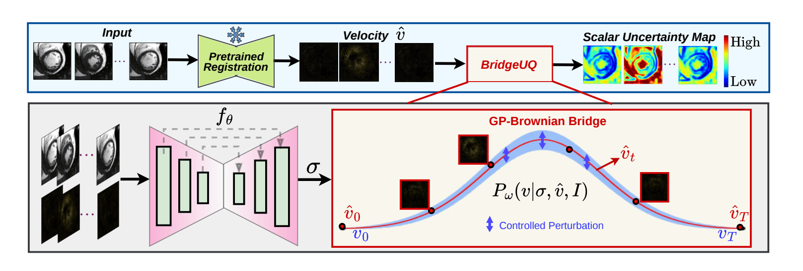

# BridgeUQ: Bayesian Aleatoric Uncertainty Quantification for Time-Series Image Registration via Brownian Bridge Prior



*An overview of BridgeUQ integrated with pretrained registration networks (Top); Detailed design of BridgeUQ (Bottom). Once trained, BridgeUQ can be used as a plug-and-play module.*

---

## Abstract

BridgeUQ is a Bayesian framework for aleatoric uncertainty quantification in pretrained deterministic registration models. Unlike prior approaches that focus on pairwise registration, BridgeUQ is the first to model posterior uncertainty over spatiotemporal deformation trajectories, capturing the intrinsic ambiguity of registration solutions across both space and time. We introduce a hierarchical Gaussian-process prior in the temporal deformation space, built on a Brownian bridge with an inverse-Gamma hyperprior on the diffusion variance, which governs stochastic sampling around the predicted registration solution. An energy-based likelihood derived from the pretrained registration objective keeps sampled deformations faithful to the observed data, and an amortized MAP scheme with conditional sampling makes posterior inference efficient. BridgeUQ is validated on cardiac cine MRI and longitudinal brain MRI with four registration backbones, where it produces anatomically meaningful uncertainty estimates and outperforms state-of-the-art UQ baselines without compromising registration accuracy.


## Installation

```bash
conda create -n bridgeuq python=3.10 -y
conda activate bridgeuq
pip install torch torchvision          # pick the build matching your CUDA
pip install numpy matplotlib tqdm
```

